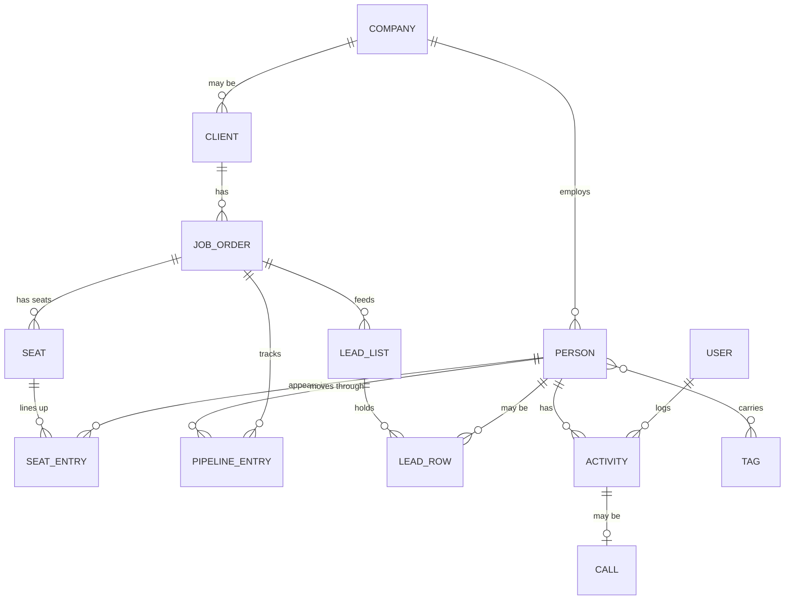

# Eden App: brief for Cody

Prepared by Q with Radar's depth-chart and Scout's lead-gen material, 15 October 2026, for Kev's review before it goes to Cody. This version names no clients and no candidates, and holds no pay, phone, email or EEO data.

## 1. The one-page version

**What Eden wants.** Its own recruiting CRM and ATS, called the Eden App, that replaces Crelate once the team has run a full week on it. It looks like Kev's blueprint (calm, cream, Montserrat, "Johnny Ive meets James Bond") and is built for the recruiter's day first.

**Two features are now core, on top of the blueprint:**

1. **Depth charts.** For each client search, a chart of seats (the roles the client needs filled), each with the people lined up behind it and where each stands. It is on the wall in the 6:30 am sessions, edited live with each recruiter, and screen-shared with clients.
2. **Lead generation.** Scout researches every job order and builds the call lists (who to call, ranked) plus the standing "market maps" of talent in each metro. Today the output is sheets in Drive. In the app it becomes data and screens.

**What we are asking Cody.** Act as architect, not vendor: design the database and the pipes, review our access and security rules, and lease Eden the Rhaven tools that fit while we build. Eden owns the data. Rhaven reads and writes through Eden's database and is never the only home of anything.

**Where we stand.** Crelate stays the system of record until the switch. A read-only mirror of Crelate in Eden's own database comes first, then screens on the mirror (depth charts and lead buckets are the first two), then write paths, then the switch. A working depth-chart tool already exists as a private prototype.

## 2. Principles (these decide most design questions)

| Principle | What it means for the build |
|---|---|
| **Eden owns its data** (Kev, 11 Oct) | Every record, call, transcript and note lands first in Eden's database. Vendors read and write through it. If a vendor leaves, Eden loses a tool, not its history. |
| **One system of record per fact** | Crelate until the switch, then the Eden App. Every copy shows its source and sync time. |
| **Read first, write last** | Each integration starts as a read. A write path is built only after the read has run cleanly for a week. |
| **Privacy by design** | No EEO fields, ever. Pay, personal email, personal phone and home address stay in the system of record and never reach sheets, screens shared with clients, logs or prompts. People appear as name, role and status. |
| **Segmented by client** | Nothing from one client shows on a screen while presenting to another. The prototype does this with closed client folders and a screen-share mode. |
| **Optional, not managed** | Partners are 1099 contractors. Training, tickets, templates and leaderboards are shown as optional resources and peer tools, not management controls. Legal reviews the wording. |
| **Spend is stepwise** | Each cost step is quoted and approved when its trigger hits. Nothing assumes a budget range. |
| **The look is part of the spec** | Cream or off-white, Montserrat, collapsible tiles, "Augusta Masters scoreboard" for performance. Kev: "Loxo's skin is far more pretty than Crelate." |

## 3. The shape of the app

Three areas, from Kev's blueprint (the "Eden App" doc and the November 2025 deep-dive notes):

| Area | What is in it |
|---|---|
| **Company Command Center** ("the Bullpen") | Landing page with revenue, active interviews, close rate, leaderboard (weekly, monthly, quarterly, annual), deal celebrations, announcements, hot job orders |
| **Personal Desk** (per recruiter) | Daily checklist that deep-links into the right list, block calendar, time-zone clock, personal scorecard and on-track gauge, notes, quick links, the daily stand-up |
| **Ecosystem** | Document and template hub, work tickets (simple forms for repeatable requests), job board, learning library ("Eden University"), RAG chatbot for recruiters |
| **Clients** (outside the firewall) | Client portal: candidates in a clean "shop" view, search status, activity on their behalf |

**Core screens, in build order that Kev has asked for so far:** (1) depth charts, (2) lead buckets for business development and recruiting, (3) scoreboard and ratios, (4) job pipeline and client job dashboards, (5) tag browser, then write paths (resume to profile, ZoomInfo upload, LinkedIn capture, client portal, resume search).

## 4. Core feature 1: depth charts

**What a depth chart is.** One chart per client search. Down the page are the seats the client wants filled (for example "Superintendent, West Palm Beach"). Under each seat are the people being worked, ranked, each with a stage. A seat with one live candidate is thin; a seat with two or more presented back-ups is healthy.

**Stages** (the prototype's list): Pending PTC, PTC, Submitted, Interview, Offer, Placed, On hold, Out. PTC is Kev's term for a candidate who has been presented to the client.

**How it works today.**

- Built from the client's Crelate portal, the client's own org chart and the recruiters' notes. Before the prototype it lived in Drive sheets, one per client.
- The prototype is a private page where editors change a status from a menu, add a name to a seat, edit, reorder, add seats, add a chart, add a client, and filter by recruiter. Each name records who added it. Viewers can only read.
- **Isolation:** the landing page shows only closed client folders. Opening one shows that client alone. A screen-share mode hides all client names; you type the client you are presenting to.
- **Shot clock** (Kev, 12 Oct): for every presented candidate, days since presented and days waiting on the client's feedback, counted in calendar days.
- **Deal desk alert:** a chart with fewer than two presented back-ups behind an interviewee is a call to make today.

**What the app must do that the prototype cannot.**

1. Every person on a chart links to their record, and every chart links to the job order (today these links are typed by hand).
2. Stages update from the pipeline instead of by hand: a submittal or interview logged on the record moves the person on the chart.
3. The shot clock computes itself from the presented date.
4. A history of changes (who moved whom, when), so the chart can be replayed for a client meeting.
5. Real roles and per-client access, so a client or a partner sees only their charts, instead of "anyone who can open the page sees everything".
6. A client-safe view for screen sharing and for the client portal: seats and counts and, where Kev decides, names.
7. A print copy.

## 5. Core feature 2: lead generation (Scout)

**The job.** "Done means a recruiter opens one sheet and starts dialing, with nothing to look up." Scout is Eden's research agent. It works two ways.

**A. A list for one live job order**

1. Read the job order (title, metro, which company types the client wants people from, must-haves).
2. Plan the pull and write it down in the list's notes.
3. Pull from ZoomInfo, one title at a time, using the Eden title tags and their real-world variants. Add a LinkedIn search string for the recruiter to run in LinkedIn Recruiter.
4. Remove every active client's people first (a protected-client rule). Referral-only and discreet clients get their own marked tab.
5. Dedupe against the CRM by LinkedIn URL, then name plus company, keeping the existing owner and last activity.
6. Tier: Tier 1 is the seat at a company type the client hires from, in the metro; Tier 2 is an adjacent title, adjacent company type or relocation distance; Tier 3 is long shots on a separate tab.
7. Write one sheet per role. Columns: number, tier, name, title, company, company type, trade, city, state, time zone (three separate columns, per Kev's 13 Oct rule, because the BPO team uploads these sheets to the CRM and each tag is read from its own column), LinkedIn, whether already in the CRM (owner, last activity), fit note, source, client flags. Recruiters fill Called and Result.
8. Hand off one line: link, counts (pulled, clients removed, already in the CRM, new by tier), the search string, anything odd.

**B. Market maps**

- For each metro: the pool by title and company type (how many people exist, how many are already in the CRM), the top employers, who is moving (layoffs, lost or won projects, leadership changes), the exact pull recipe so a refresh repeats it, and the date and source on every number.
- Refreshed on the first Monday of the month, new records only. Alerts: a daily LinkedIn Recruiter saved search per bucket and metro, a monthly ZoomInfo re-pull, and a digest of job-post applicants.
- Kev's aim: "market map the entire US and have alerts set for each major metro we're working in", so the best incoming talent is always in front of the recruiters.

**Constraints the app inherits.** ZoomInfo credits are limited (no bulk enrichment until Kev sets a budget; enrichment spends credits). ZoomInfo data is for Eden's recruiting only: never shared or resold. No personal email, phone or pay in a sheet. The standard tags (book, sector, company type, title, location as city and state and time zone) are the app's bucket hierarchy.

**What the app must do.**

1. Hold list rows as data with tier, owner, called, result and source, not as files.
2. Run the dedupe and the client-exclusion rule at load time, for every source.
3. Show the bucket hierarchy as collapsible tiles: Time Zone, then Market, then Book, then Sector, then Company Type, then Title or Company.
4. Let the BPO team load a list and have the tags land correctly without hand editing.
5. Link a list to the job order and the depth chart it feeds, so a thin seat triggers a list.

## 6. Data model (first draft for Cody to shape)

| Entity | Notes |
|---|---|
| Client, Company | A client is a company Eden works for; protected-client rules attach here |
| Job order | The search; owner recruiter; status; open date |
| Seat, Seat entry | A seat is a role on a job order; an entry is a person in a seat, with rank, stage, who added it, when, presented date, feedback date |
| Person | Candidate or client contact; tags; owner. Pay and personal contact stay in the system of record |
| Pipeline entry | Person on a job order with a stage and stage date; the source of truth for stages |
| Lead list, Lead row | List per job order or metro; rows carry tier, owner, called, result, source, ZoomInfo id |
| Activity, Call | Calls, emails, texts, meetings, submittals, interviews, notes. A call carries the transcript, extracted facts (summary, template fields, people and companies mentioned, follow-ups) and a pointer to the audio file |
| Tag | The standard tags: book, sector, company type, title, city, state, time zone, referral and the rest |
| User, role | Recruiter, researcher or BPO, admin or owner, team lead, client, partner |

## 7. How the systems connect

| System | What flows | Direction | Status |
|---|---|---|---|
| Crelate | People, companies, jobs, pipeline, activities, tags | Crelate to Eden's database nightly; later Eden writes back | API v3 verified read-only (11 and 12 Oct). Read-only mirror not yet built. |
| Eden's database (Supabase "Eden Daily") | The mirror, calls, notes, depth charts, lead lists | Hub of the whole thing | On the free plan today; the Pro upgrade ($25 a month) is queued; the login needs fixing before the mirror starts |
| CloudTalk | Calls, recordings, transcripts, AI notes | CloudTalk to Eden nightly | Connector working (health check 13 Oct). Recording every line is the next step. |
| ZoomInfo, LinkedIn | Lead pulls, saved searches | Into Scout's lists | ZoomInfo connected for Scout; LinkedIn is run by recruiters, with Scout writing the searches |
| Drive | Lead sheets, documents | Both ways until the app replaces the sheets | In use |
| Notion | Kev's ledger and journal | Not a data store for the app | In use for Kev only |
| Gmail, Superhuman, Zoom, Plaud | Source material for Radar, notes and transcripts | Into Eden's notes | In use |
| Rhaven (Cody) | Call sync, notes, deal desk inputs | Reads and writes through Eden's database | Terms and scope to be set (section 9) |

## 8. Phasing

| Phase | What | Gate to move on |
|---|---|---|
| 0, now | Mirror of Crelate in Eden's database. Depth chart prototype and the team hub. CloudTalk recording on. | Mirror row counts match Crelate; recruiters use the hub's depth charts daily |
| 1 | Screens on the mirror: depth charts (real links and stages), lead buckets, scoreboard and ratios, job pipeline | Recruiters run a week of work on the screens |
| 2 | Write paths: resume to profile, ZoomInfo upload, LinkedIn capture, client portal. Writes go to Crelate first. | Each write path runs clean for a week; first live write is an approved item |
| 3 | The switch: Crelate off | The team has run a full week on the Eden App with write paths proven |

## 9. What we ask Cody to do

**As architect (Kev's framing).** Own the schema, naming standard and access rules; approve every new table; decide what Rhaven may read and write; sign off retention and the upgrade steps with Kev.

**Deliverables, in order.**

1. Review sections 6 and 7 and mark what to change.
2. Access model: roles, per-client access, what a client or partner can ever see.
3. Hosting and scale review: is Postgres on Supabase the right home for hundreds of thousands of contacts and a growing call archive, what it costs at each step, and what "stays up" requires before the switch.
4. How Rhaven connects: the reader and writer role, and the lease terms for the tools Eden takes while building.
5. Security and privacy review: the no-EEO, no-pay rules, client segmentation, audit trail.
6. A plain estimate of the first screens (depth charts and lead buckets) with what it would take to build and who builds it.

**Questions for Cody.**

- Which parts of the Eden App does Rhaven already do, and which would Eden lease versus build?
- What does leasing cost, and what happens to the data and to Eden's customisations if the lease ends?
- Where does Rhaven store things today, and how does it move to storing through Eden's database?
- What would you choose for login, roles and client access?
- What would you change in the depth chart and lead models?

## 10. Open decisions for Kev (before this goes to Cody)

1. **Is the depth chart's client-facing view names or counts only?** My pick: counts and seats for a client on screen share, names only for Eden's own team.
2. **Share this brief with Cody as is, or after Kev edits?** My pick: Kev edits, then Radar sends it as a send item.
3. **Which parts does Kev want to lease from Cody first?** My pick: the call-sync pipe, because everything else depends on recorded calls.

## 11. Facts and what is not yet verified

| Fact | Status |
|---|---|
| Crelate API v3 works; contacts, companies, jobs return with the fields noted; no total counts, so syncs run by modified date | Verified 11 and 12 Oct |
| Crelate contact records carry EEO, salary, home address and personal email fields | Verified; the mirror copies only an approved column list |
| Crelate API has no custom picklist fields, so the bucket hierarchy is stored as tags | From the blueprint; consistent with the API probe |
| Eden's Supabase organisation is on the free plan; Pro is from $25 a month with 8 GB included | Verified on Supabase's pricing page 11 Oct |
| CloudTalk's call and recording API, and recording format | Connector verified; recording format not yet confirmed |
| Rhaven's actual feature set and pricing | Not stated in anything Eden has written down; Cody to answer |
| Crelate's contract end date and notice period | Not found; ask Kev |

## Sources

Eden App Google Doc ("APP: Eden Partner Group") and the November 2025 app deep-dive notes; `projects/eden-crm/brief.md`; Scout's lead-list, market-map, ZoomInfo and LinkedIn playbooks; Radar's deal-desk playbook; the team-hub brief (`projects/team-hub/brief.md`); the 11 to 13 October proposals in `projects/eden-crm/proposals/`.
